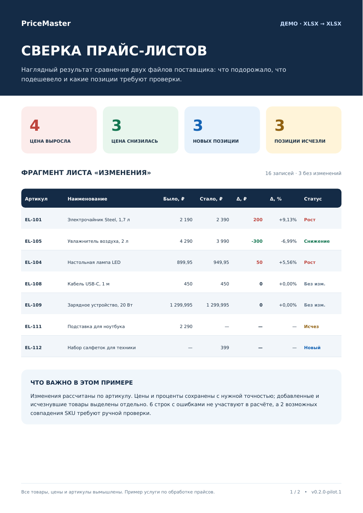
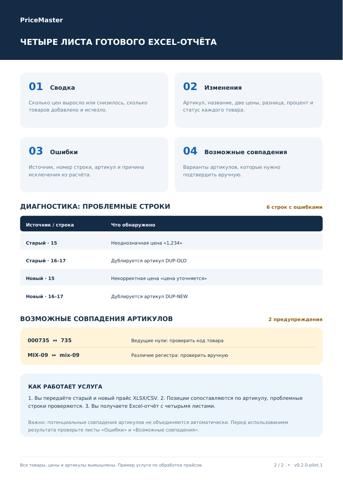

# PriceMaster — supplier price comparison

**Python engineering case study · Excel / CSV data processing · Data quality & validation**

PriceMaster is a locally executed Python utility that compares two supplier price lists by product SKU and creates a reviewable Excel report. This repository is a **public project showcase**, not a software distribution: the application source code, internal test suite, Git history and customer data remain private.

> **Status:** `v0.2.0-pilot.1` — tested prototype for a limited, manually reviewed pilot. All example data is synthetic. The application is not publicly distributed.

*Example output: sample price changes and product statuses. Report labels and the illustrative preview are in Russian.*

## Business problem and result

Comparing successive supplier price lists by hand is error-prone, especially when product identifiers change, source data contains invalid prices, or the spreadsheet layout differs between suppliers.

PriceMaster takes an **old** and a **new** price list (`.xlsx` or `.csv`) and creates a single `.xlsx` workbook with four worksheets:

| Report worksheet | Purpose |
| --- | --- |
| **Summary** (`Сводка`) | Totals for increases, decreases, unchanged, added and removed products, plus diagnostics |
| **Changes** (`Изменения`) | SKU, product name, old and new prices, absolute and percentage price change, and status |
| **Errors** (`Ошибки`) | Rejected records, original input row references and reasons for exclusion |
| **Possible matches** (`Возможные совпадения`) | Potential SKU variants requiring human review; these are **not** merged automatically |

The included demo shows **16 result rows**: **4 increases, 3 decreases, 3 unchanged, 3 added and 3 removed**. There are also **6 input-data error records** and **2 possible SKU-match warnings**. Warnings are separate from confirmed matches.

## Explore the sample without installing anything

| Downloadable artifact | Description |
| --- | --- |
| [`demo/PriceMaster_OLD.xlsx`](demo/PriceMaster_OLD.xlsx) | Synthetic old supplier price list |
| [`demo/PriceMaster_NEW.xlsx`](demo/PriceMaster_NEW.xlsx) | Synthetic new supplier price list |
| [`demo/PriceMaster_REPORT.xlsx`](demo/PriceMaster_REPORT.xlsx) | Actual report generated by the private PriceMaster pilot build |
| [`demo/PriceMaster_REPORT_preview.pdf`](demo/PriceMaster_REPORT_preview.pdf) | Two-page, Russian-language illustrated report overview |

The sample is deliberately designed to contain malformed and ambiguous records so the data-quality checks can be seen. The report was generated by the program, not reconstructed by hand for the showcase.

## Engineering approach

- **Deterministic matching:** exact SKU equality, with separate *advisory* detection of case, separator and numeric-leading-zero variations.
- **Numeric correctness:** calculations use Python `Decimal`; ambiguous price separators are validated instead of guessed.
- **Input robustness:** supports configurable CSV conventions and XLSX sheet/header selection; corrupted workbooks cause a controlled failure.
- **Result integrity:** guards against empty or entirely unusable inputs and potentially unreliable add/remove statuses; failure must not replace a valid existing report.
- **Export safety:** potentially formula-like supplier text is treated as text and the output must have the `.xlsx` extension.
- **Auditability:** diagnostic worksheets record rows excluded from comparison and unconfirmed SKU suggestions.

**Scope boundaries:** at most 5,000 non-empty item rows per input list; the application does not perform fuzzy product-name matching, exchange-rate conversion, marketplace integration, or unattended catalog synchronization. Client input conventions and warnings must be checked before results are acted on.

## Verification

The private engineering version completed **161 automated tests plus 70 subtests**, and **20/20 synthetic acceptance scenarios**, as recorded for the `v0.2.0-pilot.1` snapshot (October 2026). These are historical local test results, **not** a public CI badge, an independently audited certification or proof of correctness for arbitrary customer files.

The public showcase intentionally omits production source code and automated tests. Its XLSX samples let visitors inspect representative inputs and output, but do not allow independent execution of PriceMaster.

## Availability

PriceMaster is used as an **engineering portfolio example** and as a potential basis for **custom, scoped supplier-data analysis and reporting work**. This public repository does not provide the application or grant a software license.

For professional inquiries, use the [GitHub profile](https://github.com/coolinar).

---

*All products, identifiers and prices shown here are fictional. This is an example of a manually reviewed data-processing workflow, not a live client deployment.*
